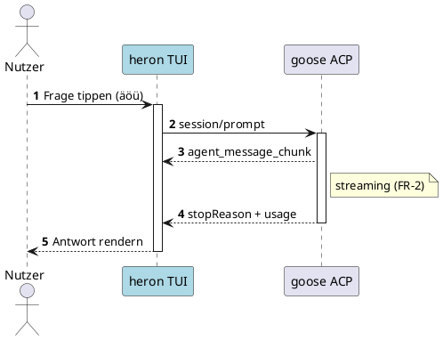
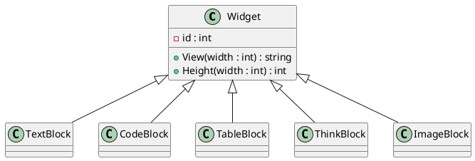
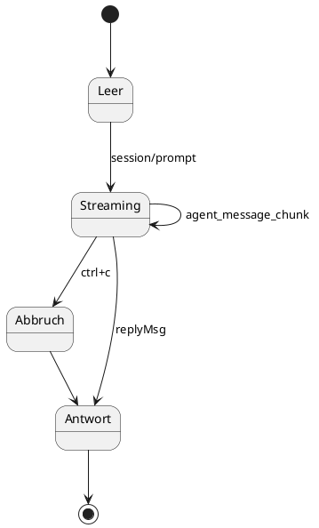
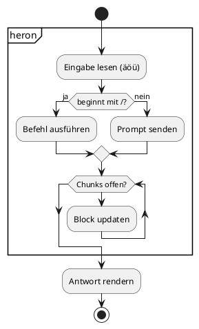
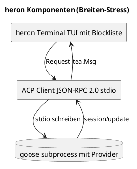
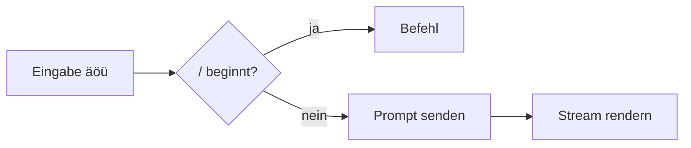
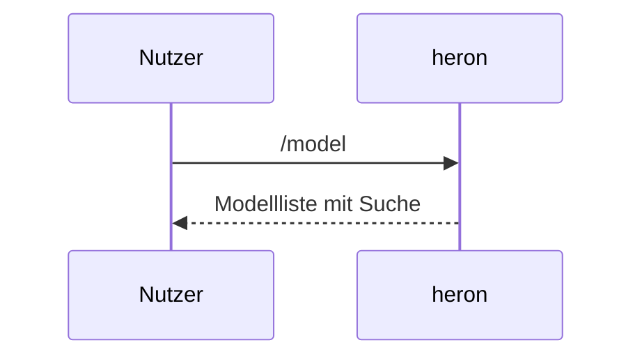
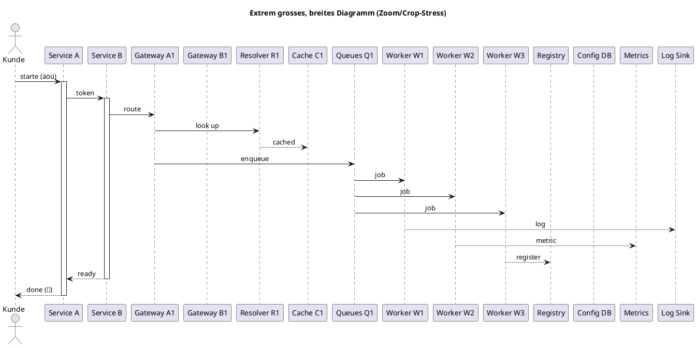

# Markdown-Quirks-Referenz

Katalog aller Markdown-Sonderfälle: **Nummerierte Überschrift = Elementname** (das, was in
Markdown normalerweise anders angezeigt wird), direkt darunter das Beispiel. Sichtprüfungs-
Referenz für den Renderer. Rendern mit:

```
heron --seed docs/quirks-test.md
go run ./examples/render -width 90 docs/quirks-test.md
```

Erwartetes Grundverhalten (FR-16): Inline-Markup rendert als Text — die Marker verschwinden,
der Inhalt bleibt.

## 1. Überschriften H1–H6

# H1
## H2 mit `Inline-Code`
### H3 mit *Emphase*
#### H4
##### H5
###### H6

## 2. Setext-Überschriften

Setext-H1 (Gleichheitszeichen)
==============================

Setext-H2 (Bindestriche)
------------------------

## 3. Keine Überschriften

#keinHeadingOhneSpace — Raute ohne Leerzeichen ist Fließtext

# (leere Raute — gültige, leere Überschrift)

####### Sieben Rauten sind kein Heading

## 4. Emphase

*kursiv* und _auch kursiv_

## 5. Strong

**fett** und __auch fett__

## 6. Emphase + Strong kombiniert

***alles zusammen*** und **`strong mit Code`**

## 7. Durchgestrichen (GFM)

~~durchgestrichen~~

## 8. Inline-Code

`Inline-Code` und ``Code mit ` Backtick`` und `` ` `` einzeln

## 9. Backslash-Escapes

\*keine Emphase\*, \#kein Heading, \_kein\_ Unterstrich, \\ Backslash, \` kein Code, \- kein Listenpunkt, \< kein HTML, \! kein Bild, \[ keine Referenz

## 10. HTML-Entities

&amp; &lt; &gt; &copy; &auml; &nbsp; — bleiben literal stehen (kein HTML-Rendering)

## 11. Raw-Sonderzeichen

Der Vergleich a < b und c > d sowie & und " und ' sind unproblematisch

## 12. Inline-Link

[Link mit Titel](https://example.invalid "Titel") und [ohne Titel](https://example.invalid) — nur das Label bleibt, die URL fällt weg (FR-16)

## 13. Referenz-Link

[Referenz-Link][ref] und ein [collapsed][] — Definitionen stehen ganz unten und rendern nicht

## 14. Autolink (spitze Klammern)

<https://example.invalid/autolink> und <kontakt@example.invalid>

## 15. Linkify (GFM, nackte URLs)

https://example.invalid/bare und www.example.invalid/www und kontakt@example.invalid — Linkify rendert die URL als Text

## 16. Langes URL (Umbruch-Stress)

https://example.invalid/sehr/langer/pfad/der/den/Umbruch/stressen/soll/aaaaaaaaaaaaaaaaaaaaaaaaaaaaaaaaaaaaaaaaaaaaaaaaaaaaaaaaaaaaaaaaaaaaaaaaaaaaaaaaaaaaaaaaaaaaaaaaaaaa

## 17. Bild

 — nur der Alt-Text bleibt, ! und URL fallen

## 18. Bild in Link

[](https://example.invalid/target)

## 19. Soft Break (einfache neue Zeile)

Erste Zeile (Soft Break),
zweite Zeile direkt danach — Zeile bleibt Zeile, nichts klebt

## 20. Hard Break (zwei Leerzeichen am Zeilenende)

Zeile A  
Zeile B — die Leerzeichen sind unsichtbar, der Umbruch muss trotzdem sein

## 21. Hard Break (Backslash am Zeilenende)

Zeile C\
Zeile D — Wörter dürfen nie zusammenkleben

## 22. Listen mit gemischten Markern

- Bindestrich-Punkt
- zweiter Punkt
* Stern-Punkt
+ Plus-Punkt

## 23. Nummerierte Liste mit Startwert

5. fünfter Punkt
6. sechster Punkt
7. siebter

## 24. Task-Liste (GFM)

- [x] erledigt
- [ ] offen
- [X] großgeschrieben abgehakt — Checkbox MUSS sichtbar bleiben

## 25. Verschachtelte Liste (drei Ebenen)

- Ebene 1
  - Ebene 2
    - Ebene 3
  - zurück auf Ebene 2
- zurück auf Ebene 1

## 26. Lose Liste (zwei Absätze pro Eintrag)

- erster Absatz des Eintrags

  zweiter Absatz desselben Eintrags
- nächster Eintrag

## 27. Listeneintrag mit Inline-Markup

- Punkt mit `Code` und **fett** gemischt

## 28. Klammer-Stil `1)` (GFM)

1) Klammer-Stil
2) zweiter mit Klammer

## 29. Blockquote

> Einfaches Zitat mit äöüß und 🚀.

## 30. Verschachteltes Blockquote

> außen
> > innen
> > > tief innen

## 31. Blockquote mit Liste

> Zitat mit Code: `inline` und
> > - Punkt A
> > - Punkt B

## 32. Lazy Continuation (Zitat ohne Marker)

> diese Zeile gehört
noch zum Zitat ohne `>`-Marker

## 33. Code-Block (Backtick-Fence)

```text
Klassischer Backtick-Fence
zweite Zeile
```

## 34. Code-Block (Tilde-Fence)

~~~text
Tilde-Fence mit Inhalt
~~~

## 35. Code-Block eingerückt (4 Spaces)

    func eingerückt() string {
        return "4-Spaces-Code"
    }

MUSS als Codeblock erscheinen — darf nicht verschluckt werden.

## 36. Fence mit Info-String-Extras

```go title="beispiel.go" linenums
fmt.Println("Info-String mit Extras")
```

## 37. Code mit Tabs (expandiert zu 4 Spaces)

```go
func tabby() {
	s := "tab	und	noch	eins"
	_ = s
}
```

## 38. Code mit sehr langer Zeile (weicher Umbruch)

```text
AAAAAAAAAAAAAAAAAAAAAAAAAAAAAAAAAAAAAAAAAAAAAAAAAAAAAAAAAAAAAAAAAAAAAAAAAAAAAAAAAAAAAAAAAAAAAAAAAAAAAAAAAAAAAAAAAAAAAAAAAAAAAAAAAAAAAAAAAAAAAAAAAAAAAAAAAAAAAAAAAAAAAAAAAAAAAAAAAAAAAAAAAAAAAAAAAAAAAAAAAAAAAAAAAAAAAAAAAAAAAAAAAAAAAAAA
```

## 39. Code mit Pipes (KEINE Tabelle)

```text
| Diese | Pipes | sind | kein | Table |
```

## 40. Code mit Unicode und Trailing-Whitespace

```python
print("你好 🚀 äöü")
```

```text
Zeile mit Leerzeichen am Ende:  
nächste Zeile
```

## 41. Leerer Code-Block

```
```

## 42. Vier-Backticks-Fence mit innerem Dreifach-Fence

````text
Beispiel:
```go
fmt.Println("innere Fence")
```
Ende Beispiel.
````

## 43. Tabelle (Standard)

| Funktion | Status | Bemerkung |
|---|---|---|
| Streams | ✅ | agent_message_chunk live |
| Denk-Block | ✅ | äöü und 🚀 im Text |
| Copy | 🟡 | OSC52 + Fallback |

## 44. Tabellen-Alignment (alle vier Varianten)

| Default | Links | Zentriert | Rechts |
|---------|:------|:---------:|-------:|
| zelle | links | mitte | rechts |
| länger | x | y | 42 |
| `code` | **fett** | ~~strike~~ | [Link](https://x.invalid) |

## 45. Escaped Pipe in Zelle

| Ausdruck | Bedeutung |
|----------|-----------|
| `a \| b` | Pipe in Inline-Code |
| a \| b | Pipe im Klartext |

## 46. Leere Zellen

| Gefüllt | Leer | Auch leer |
|---------|------|-----------|
| a | | |
| | b | c |

## 47. Ragged Row (weniger Zellen als Header)

| A | B | C |
|---|---|---|
| 1 | 2 | |
| nur eine | | |

## 48. Ein-Spalten-Tabelle

| Einzel |
|--------|
| einzig |

## 49. Tabelle nur mit Header

| Kopf1 | Kopf2 |
|-------|-------|

## 50. Emoji als Tabellen-Header

| 🚀 | ⚠️ |
|----|----|
| ok | auch ok |

## 51. Viele Spalten (Breiten-Stress)

| Spalte 1 | S2 | S3 | S4 | S5 | S6 | S7 | S8 |
|---|---|---|---|---|---|---|---|
| Viele | Spalten | müssen | ohne | Bruch | nebeneinander | passen | ✓ |
| 1 | 2 | 3 | 4 | 5 | 6 | 7 | 8 |

## 52. Zelle mit langem Fließtext

| Sehr lange Zelle | Kurz |
|---|---|
| Diese Zelle enthält einen sehr langen Fließtext mit Umlauten äöüß und muss sauber in der Zelle weich umbrechen, ohne die Tabelle zu zerstören oder Nachbarzellen zu verschieben. | ok |

## 53. Horizontale Linien

---

***

___

## 54. CJK (doppelt breit)

你好世界 (Chinesisch), こんにちは (Japanisch), 안녕하세요 (Koreanisch)

## 55. Fullwidth-Zeichen

ＦＵＬＬＷＩＤＴＨ (Fullwidth-Latein), ｶﾀｶﾅ (Halbbreit-Katakana)

## 56. Combining Diacritics (zwei Codepoints, eine Zelle)

é (e + Akut), ä (a + Trema) — und normal ä ö ü zum Vergleich

## 57. ZWJ-Emoji-Familie

👨‍👩‍👧‍👦 — ein Emoji aus vielen Codepoints, darf nicht zerfallen

## 58. Flaggen und Variationsselektoren

🇩🇪 — ☺️ vs ☺ — ☺️ zählt im Terminal 2 Zellen, ☺ nur 1

## 59. RTL-Text

Hebräisch: שלום und Arabisch: مرحبا im Satz

## 60. Geschützte Leerzeichen

Ein geschütztes Leerzeichen (U+00A0) mitten&nbsp;im Satz — und ein schmales U+202F hier — sowie das Megawort 超長的德語組合字Donaudampfschifffahrtsgesellschaftskapitänsmützenhalterschraubenbeschlagstofffabrikantenersatzteildepotlagerverwaltungssoftware漢字テスト

## 61. Inline-HTML (Tags fallen weg, Inhalt bleibt)

Inline: <b>fett via HTML</b> und <span style="color:red">rot via Span</span>

## 62. HTML-Block (verschwindet komplett)

<div class="block">Dieser HTML-Block-Text verschwindet im Render</div>

<script>alert(1)</script> — als HTML-Block verschwindet die ganze Zeile

## 63. HTML-Kommentar (unsichtbar)

<!-- ein Kommentar — erscheint nirgends -->

## 64. Fußnoten-Syntax (GFM-Extension inaktiv → literal)

Fußnote[^1] bleibt wörtlich — inklusive Definition:

[^1]: Diese Definition steht als Fließtext da.

## 65. Definitionslisten-Syntax (nicht in GFM → Fließtext)

Begriff
: Definitionssyntax bleibt Text

## 66. Math-Syntax (kein Renderer aktiv → literal)

Inline $x^2$ und Block:

$$
\int_0^1 x\,dx = \tfrac{1}{2}
$$

## 67. Mentions und Hashtags

@mention und #hashtag und ein mitten#im#Satz — reiner Text

## 68. Mehrfach-Leerzeilen (genau ein Block-Abstand)


Nach den Leerzeilen — kein Riesengap

## 69. PlantUML Sequenz (autonumber, activate, note, Umlaute)



## 70. PlantUML Klassendiagramm



## 71. PlantUML State-Diagramm



## 72. PlantUML Activity (partition, if/else, while)



## 73. PlantUML Komponente (breit — Wrap-Stress)



## 74. PlantUML ohne @startuml/@enduml (Konvertierung scheitert → Roh-Text)

```plantuml
A -> B : kein Rahmen
```

## 75. PlantUML absichtlich kaputt (Roh-Text-Fallback, FR-6)

```plantuml
@startuml
das ist }{ kein gültiges diagram <<<>>>
@enduml
```

## 76. Mermaid Flowchart (ohne mmdc bleibt Klartext, FR-28)



## 77. Mermaid Sequenz


## 78. PlantUML extrem breit (Zoom/Crop-Stress)

Sehr breites Sequenzdiagramm (viele Teilnehmer -> grosses intrinsisches SVG).
Im Pan-&-Zoom-Modus (Enter, dann + ) wird die Rechtskante sehr schnell vom
Fenster geschnitten -> der virtuelle Raster muss an der Diakritika-Grenze
stoppen, damit nur ein Ausschnitt gezeigt wird, ohne Bildartefakte (Zebra).




[ref]: https://example.invalid/referenz
[collapsed]: https://example.invalid/collapsed

Ende der Referenz. Beim Durchsehen prüfen: nichts verschwindet still, keine Zeile klebt
zusammen, Copy-IDs (alt+<n>) auf jedem Block, Hotkeys (C/+/T/I) und Neon-Fokus-Rahmen
funktionieren, Diagramme konvertieren oder fallen sauber auf Roh-Text zurueck.
