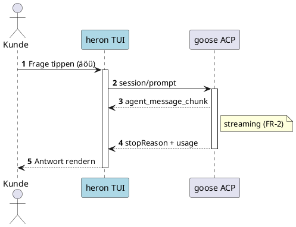
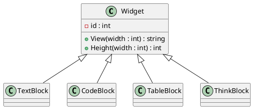
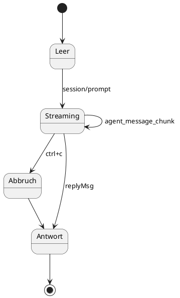
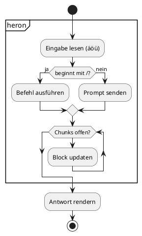
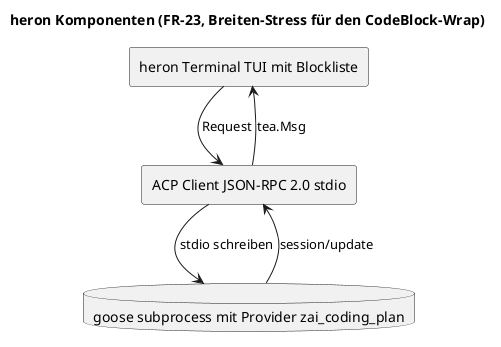
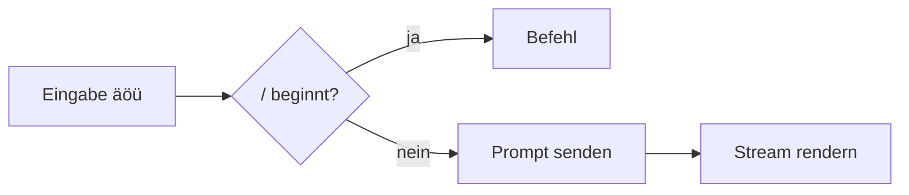
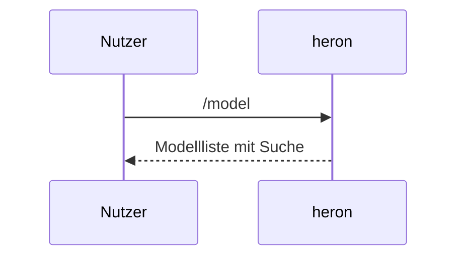

# heron Render-Test

Diese Datei stress-testet alle Renderer-Pfade. Rendern mit:
`heron --seed docs/render-test.md` oder `go run ./examples/render -width 100 docs/render-test.md`.

Absatz mit Umlauten (äöüß ÄÖÜ), Emoji (🚀 ✅ ⚠️ 📊 🔧), Sonderzeichen (`<html>`, `&`, `"Quotes"`),
Box-Zeichnen ┌─┐│└┘ und einem sehr langen Wort ohne Leerzeichen:
Donaudampfschifffahrtsgesellschaftskapitänsmützenhalterschraubenbeschlagstofffabrikantenersatzteildepot AssemblyVersion

**Inline-Markdown**: *kursiv*, **fett**, `inline code`, [Link](https://example.invalid) und Code mit Pipe `a|b` — Inline rendert als Text (FR-16), nichts darf crashen.

## Code-Blöcke (FR-37, Chroma)

```go
package main

import "fmt"

func main() {
	// Umlaute im Kommentar: äöüß ÄÖÜ
	for i := 0; i < 3; i++ {
		fmt.Printf("heron %d 🚀\n", i)
	}
}
```

```python
def gruss(name: str = "Welt") -> str:
    """Docstring mit Umlauten äöü."""
    return f"Hallo {name} 🚀"

print(gruss("heron"))
```

```shell
# Shell mit Pipes und Quotes
echo "a|b" | grep -c "a" || true
git log --oneline | head -5
```

```json
{
  "modell": "glm-5.3",
  "effort": "max",
  "emoji": "🚀",
  "zahl": 42,
  "liste": ["a", "b|c"]
}
```

```foobar-unklar
Unbekannte Sprache — muss als Klartext-Fallback ohne Fehler rendern (FR-37).
Zweite Zeile mit Umlauten äöü.
```

Leerer Block:
```
```

Block mit Pipes — das ist KEINE Tabelle:
```
| Diese | Pipes | sind | wirklich | kein | Table |
```

Vier-Backticks-Fence mit drei Backticks innen (goldmark muss schachteln):
````text
Beispiel:
```go
fmt.Println("innere Fence")
```
Ende Beispiel.
````

## Tabellen (FR-2/FR-8)

| Funktion | Status | Bemerkung |
|---|---|---|
| Streams | ✅ | agent_message_chunk live |
| Denk-Block | ✅ | äöü und 🚀 im Text |
| Copy | 🟡 | OSC52 + Fallback |

| Links | Zentriert | Rechts |
|:------|:---------:|-------:|
| a | b | c |
| längerer Text | äöüß | 42 |
| 🚀 Emoji | `code` | **fett** |

| Spalte 1 | S2 | S3 | S4 | S5 | S6 | S7 | S8 |
|---|---|---|---|---|---|---|---|
| Viele | Spalten | müssen | ohne | Bruch | nebeneinander | passen | ✓ |
| 1 | 2 | 3 | 4 | 5 | 6 | 7 | 8 |

| Sehr lange Zelle | Kurz |
|---|---|
| Diese Zelle enthält einen sehr langen Fließtext mit Umlauten äöüß und muss sauber in der Zelle weich umbrechen, ohne die Tabelle zu zerstören oder Nachbarzellen zu verschieben. | ok |

## PlantUML (FR-6, ASCII via plantuml -ttxt)

Sequenz mit autonumber, Aktivierung, Farbe, Umlauten. **Sonderfall:** `note right of` crasht
plantuml 1.2026.8 im ASCII-Modus (NoteTile-Bug) — heron muss hier sauber den Roh-Text-Fallback
zeigen (FR-6):



Klassendiagramm (Widget-Hierarchie):



State-Diagramm (Turn-Lebenszyklus):



Activity mit Partition, If/Else und Schleife:



Komponente mit Titel und skinparam (breit — Wrap-Stress):



Absichtlich KAPUTT — muss als Roh-Text-Fallback erscheinen, kein Crash (FR-6):

```plantuml
@startuml
das ist }{ kein gültiges diagram <<<>>>
@enduml
```

## Mermaid (FR-28 — aktuell Klartext-CodeBlock, kein Crash)





## Bild-Terminal-Protokoll (FR-27, geplant — Kitty/Sixel)

Der PNG-Pfad über Kitty-/Sixel-Protokoll ist offen (FR-27): PlantUML liefert hier ASCII
(`-ttxt`), PNG-Bilder folgen über Tag-Routing (FR-4). Manueller Protokoll-Test außerhalb
von heron:

```shell
# kitty: Bild direkt ins Terminal
kitty +kitten icat docs/assets/logo.png 2>/dev/null || echo "kitty-Test außerhalb von kitty"
# Validierung der PlantUML-Blöcke:
plantuml -ttxt -p < diagramm.puml
```

## Edge-Cases

- Aufzählung mit äöü
- Zweiter Punkt
  - Verschachtelt

1. Nummerierte Liste
2. Zweiter Eintrag

> Blockquote mit einem längeren Satz, der umbricht: äöüß und ein 🚀.

---

Zeile mit Tab-Indent (muss als Code oder Text sauber bleiben):

	dieses Tab richtet aus

Zeile mit Trailing-Spaces:   
HTML-Inline: <b>fett via HTML</b> — darf nicht crashen.
Sehr langes zusammenhängendes Token ohne Leerzeichen für den Wrap-Test:
Donaudampfschifffahrtsgesellschaftskapitänsmützenhalterschraubenbeschlagstofffabrikantenersatzteildepotlagerverwaltungssoftware

Ende des Render-Tests. Alle Blöcke müssen Copy-IDs haben (alt+<n>), Tabellen wachsen zeilenweise,
PlantUML konvertiert im Hintergrund, der Mermaid-Block bleibt Klartext (FR-28 offen).