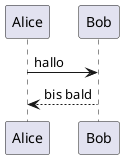

# Vorschau — heron Rendern

Fliesstext wird an der Terminalbreite umgebrochen. **Fett** und *kursiv* kommen aus dem
Markdown, Umlaute wie äöüß und Emoji 🎉 bleiben erhalten.

## Tabellen

| Komponente | Zustand | Notiz |
|---|---|---|
| Renderer | fertig | Codeblock mit Copy-Box |
| Clipboard | OSC52 | Fallback wl-copy/xclip/pbcopy |
| Sessions | offen | M3 |

## Code

Go:

```go
package main

import "fmt"

// main gibt einen Gruß aus.
func main() {
	name := "heron"
	for i := 0; i < 3; i++ {
		fmt.Printf("hallo %s (%d)\n", name, i)
	}
}
```

Python:

```python
from dataclasses import dataclass

@dataclass
class Message:
    role: str
    content: str


def render(msg: Message) -> str:
    return f"[{msg.role}] {msg.content}"
```

Shell:

```bash
set -euo pipefail
nix develop -c go test ./...
echo "fertig"
```

JSON:

```json
{
  "name": "heron",
  "protocol": "acp",
  "version": 2
}
```

## Listen

- Erster Punkt
- Zweiter Punkt mit `inline-code`
  - Verschachtelt

1. Nummeriert
2. Ebenfalls nummeriert

## Diagramm (PlantUML)



## Zitat

> Alles Rendering liegt im Client — deshalb können wir Codeblöcke frei übersteuern.

---

Ende der Vorschau.
